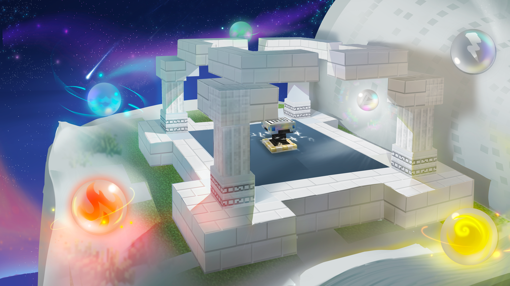

# Essence Odyssey · 本源远征

**中文** · [English](README_EN.md)

这是一个围绕科技、魔法与冒险构建的整合包。探索六大维度，解析六大元始要素，建立跨模组生产线，并通过仪式与自动化逐步迈向终局。踏上这场跨越世界的远征，寻找世界的本源。

CurseForge 项目页：<https://www.curseforge.com/minecraft/modpacks/essence-odyssey>

## 故事线

你是方块世界的一个普通人。某天，你发现了一本笔记，里面描述的世界和你熟悉的不太一样——紫水晶会对某些东西有反应，世界似乎在回应着什么。你不知道为什么，但你想知道为什么。你跟着这本笔记走了下去。

你走过六个维度，收集六种元始要素。你发现了一颗陨石，里面藏着一段不属于任何已知文明的记录。你破译了它，第一次看清这个世界是怎么运转的。

后来你开始用科技与魔法把要素转化成不同形态，量产要素，组合元始要素为二级要素，一步步接近那个你最初无法理解的问题——世界为什么在回应你。

没有人告诉你该往哪走。你只有一份笔记，和一条你自己走出来的路。

## 核心玩法

### 六大维度，六种元始要素

| 维度 | 主世界 | 下界 | 暮色森林 | 天境 | 末地 | 永恒星光 |
|---|---|---|---|---|---|---|
| 要素 | 水 | 火 | 地 | 风 | 混沌 | 秩序 |

每个维度都有独特的要素获取方式。用紫水晶碎片与维度互动，即可获得对应的要素结晶。

### 要素形态贯穿全程

从固态结晶到液态流体，再到气态精粹，中间穿插自然灵气（Nature's Aura）印记、新生魔艺（Ars Nouveau）魔法精华、命血术（Neo Vitae）铭文工具、植物魔法（Botania）符文等衍生物。各种形态各有获取方式与用途，层层递进，不会一次全部开放。

### 二级要素合成体系

六种元始要素两两组合，共 15 种二级要素。生产路线不止一条，可以按自己走的科技线选择（尚未完成）。

### AE2

AE2 从游戏早期就融入进度，不是后期才解锁。

### 三条线交织

科技、魔法、冒险三条线并行，彼此交织。

## 安装与游玩

1. 在 [CurseForge 项目页](https://www.curseforge.com/minecraft/modpacks/essence-odyssey) 安装稳定版（Minecraft 1.21.1 ＋ NeoForge 21.1）。
2. 内存建议分配 6–8 GB。

## 开发状态

整合包处于早期开发阶段，进度在第二章，主线任务和终局内容尚未完成。你可能会遇到占位内容或“刻意的游戏设计”。

开发期间只提供完整的中文游戏内容和基本的英文内容（英文从 0.2.2 起提供，后续版本持续补充）。主要内容与系统基本完成后，再完善英文翻译与本地化。

遇到问题可以在 [Issues](https://github.com/hydrogenfluoride233/Essence-Odyssey/issues)、CurseForge 项目页或官方 QQ 群（1077071243）反馈。

## 开发版与参与开发

这个仓库是整合包的开发实例，开发中的内容直接提交到这里。想玩稳定版请去 CurseForge。

| 想做的事 | 看哪里 |
|---|---|
| 跑最新的开发版 | [`同步说明.md`](同步说明.md)：clone 仓库，再运行 `sync-and-play.bat`（macOS / Linux 用 `sync-and-play.command`）补齐模组与配置 |
| 提 PR 或 issue | [`.github/CONTRIBUTING.md`](.github/CONTRIBUTING.md)：提交格式、PR 说明的写法、哪些文件不收改动 |

开发版是未发布的内容，可能有 bug，也不保证存档兼容。

## 仓库结构

仓库只收作者手写或手改的内容，以及 packwiz 清单。第三方模组本体不入库，按清单从 CurseForge 下载。

| 路径 | 内容 |
|---|---|
| `kubejs/startup_scripts/` | 启动脚本：注册物品、方块、流体、化学品与多方块机器 |
| `kubejs/server_scripts/` | 服务端脚本：配方（`recipes/` 按模组分目录）、标签、多方块结构与配方（`MMCR/`）、物品提示、村民交易 |
| `kubejs/client_scripts/` | 客户端脚本：配方查看器里隐藏的物品与配方，以及补充的信息页 |
| `kubejs/assets/`、`kubejs/data/` | 补充汉化、自制贴图与模型；数据包覆盖 |
| `config/` | 模组配置；任务书在 `config/ftbquests/`，玩家默认设置在 `config/defaultoptions/` |
| `defaultconfigs/` | 新存档与新客户端拿到的默认配置 |
| `mods/` | 模组的 packwiz 记录（`*.pw.toml`）。入库的 jar 只有两个：`Aether's Delight`（不在 CurseForge 上）和自研核心模组 `Essence Odyssey Core` |
| `resourcepacks/` | 随包分发的 CFPA 汉化资源包，以及两个资源包的 packwiz 记录 |
| `shaderpacks/` | 光影的 packwiz 记录 |
| `pack.toml`、`index.toml` | packwiz 清单：整合包版本、Minecraft 与 NeoForge 版本、每个文件的哈希 |
| `sync-and-play.bat`、`sync-and-play.command`、`packwiz-installer-bootstrap.jar` | 开发版同步脚本，用法见 [`同步说明.md`](同步说明.md) |
| `.github/` | 贡献说明、issue 模板与 README 用图 |

## 贡献者（排名不分先后）

| 角色 | 贡献 | 联系方式 |
|---|---|---|
| **hydrogenfluoride/钴蓝** | 作者：内容取舍、数值平衡、KubeJS 脚本、设定与文案 |[GitHub](https://github.com/hydrogenfluoride233)|
| **sweetcornna** | 贡献者：代码与设计建议、部分美术资产 |[GitHub](https://github.com/sweetcornna)|
| **剑歇** | 贡献者：提供创意与设计建议，文本整合 |[Bilibili](https://space.bilibili.com/433356862)|
| **丘山** | 贡献者（？）：核心模组的第一个 issue |[GitHub](https://github.com/PWJCSqiushan)|
| **萧云** | 美术：标题画面插画 |[Bilibili](https://space.bilibili.com/332020920)|
| **外婆家地头的卷心菜** | 测试：测试游戏中实际表现，提供游玩反馈 |[Bilibili](https://space.bilibili.com/1916920800)|
| **XiaoY** | 测试：反馈了100个滚木 |[Bilibili](https://space.bilibili.com/631876173)|
| **小岛** | 测试：hf老师做的太好导致测试了滚木 |[Bilibili](https://space.bilibili.com/1411422673)|
| **铁陵-irontomb** | 测试：提供游玩反馈 |[Bilibili](https://space.bilibili.com/1679358153)|
| **氯化钠** | 吉祥物：（说了一些关于本源远征的话） |[Bilibili](https://space.bilibili.com/508963951)|
| **陌屿君** | 吉祥物：真的不在摸鱼！ |[Bilibili](https://space.bilibili.com/499977642)|
| **其琛琛琛** | 吉祥物：给予蓝狼言语上的支持与鼓励 |[Bilibili](https://space.bilibili.com/541846318)|

## 授权｜License

| 范围 | 许可 |
|---|---|
| 整合包本体，以及 `config/`、`defaultconfigs/`、`data/`、`kubejs/` 下的配置、数据、资源与汉化 | [CC BY-NC-SA 4.0](https://creativecommons.org/licenses/by-nc-sa/4.0/deed.zh-hans)（署名—非商业性使用—相同方式共享） |
| `kubejs/` 目录下作者原创的 `.js` 脚本 | [MIT](kubejs/LICENSE) |
| 自研核心模组 `Essence Odyssey Core`（`essenceodyssey`） | All Rights Reserved；允许未修改的二进制随本整合包分发，正式版亦发布在 CurseForge；不用于其它整合包、不提供公共 API |
| 第三方内容（各模组、社区汉化、他人素材） | 各自原始许可，见 [THIRD-PARTY.md](THIRD-PARTY.md) |

上表的 CC BY-NC-SA 4.0 不覆盖 `mods/` 下的两个裸 jar（`Aether's Delight` 与自研核心模组），它们按各自项目与上表的条款分发。

转载或改编请注明「Essence Odyssey / 本源远征 by hydrogenfluoride」、附协议链接并标明是否改动；禁止商业使用；改编作品需以相同协议发布。协议全文见 [LICENSE](LICENSE)。
