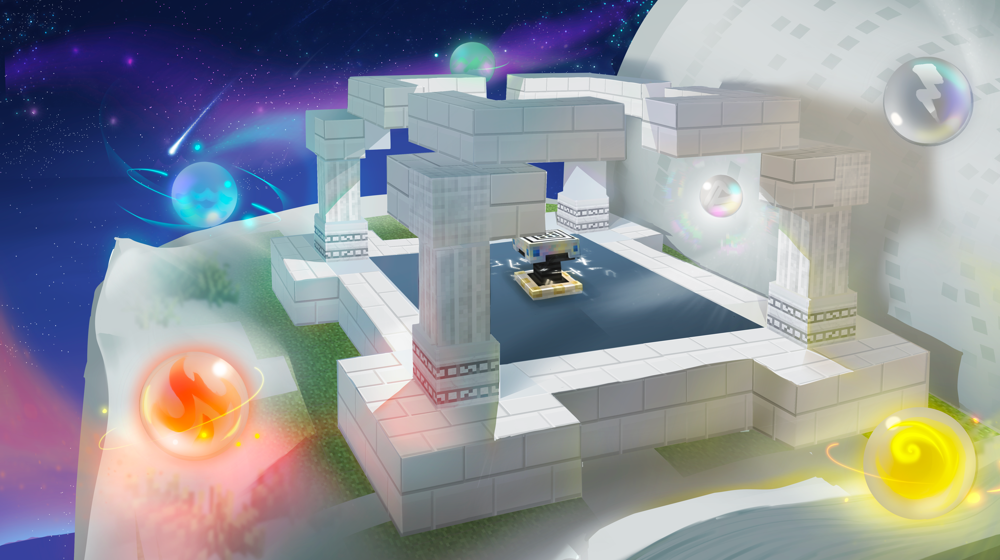

# Essence Odyssey

[中文](README.md) · **English**

This is a modpack built around technology, magic, and adventure. Explore six dimensions, unravel the six primary aspects, establish cross-mod production lines, and progress toward the endgame through rituals and automation. Embark on an odyssey across worlds, and seek the origin of the world.

CurseForge page: <https://www.curseforge.com/minecraft/modpacks/essence-odyssey>

## Story

You are an ordinary person in the world of Minecraft. One day you find a note — the world it describes is not quite the one you know: amethyst shards react to something, and the world seems to be responding. You don't know why. But you want to know why. You follow that note and keep walking.

You walk through six dimensions and gather six primary aspects. You find a meteorite. Hidden inside it is a record that belongs to no civilization you know of. You decipher it, and for the first time see how this world works.

Later you begin using technology and magic to turn aspects into other forms, mass-producing them, and combining primary aspects into secondary ones — step by step closing in on the question you could not answer at first: why is the world responding to you?

No one tells you where to go. You have only a note, and a path you walked for yourself.

## Core Gameplay

### Six dimensions, six primary aspects

| Dimension | Overworld | Nether | Twilight Forest | The Aether | The End | Eternal Starlight |
|---|---|---|---|---|---|---|
| Aspect | Water | Fire | Earth | Air | Chaos | Order |

Each dimension has its own way of obtaining aspects. Interact with a dimension using amethyst shards to obtain the matching aspect crystals.

### Aspect forms run through the entire progression

From solid crystals to liquid fluids, and on to gaseous quintessence, with Nature's Aura tokens, Ars Nouveau essences, Neo Vitae inscription tools, and Botania runes appearing in between. Each form has its own way of being obtained and its own uses, opening up layer by layer rather than all at once.

### Secondary aspect crafting

Pairing the six primary aspects gives 15 secondary aspects. There is more than one production route, so you can choose one that fits your tech line (not yet complete).

### AE2

AE2 is part of the progression from early on, rather than something unlocked later.

### Three threads, interwoven

Technology, magic, and adventure run in parallel and interweave.

## Installing and Playing

1. Install the stable release from the [CurseForge page](https://www.curseforge.com/minecraft/modpacks/essence-odyssey) (Minecraft 1.21.1 + NeoForge 21.1).
2. Allocate 6–8 GB of memory.

## Development Status

This modpack is in early development. Progress currently stands at Chapter 2; the main questline and the endgame are not finished yet. You may run into placeholder content, or the occasional "Intentional Game Design".

During development, the pack ships complete Chinese content and basic English content (English support began with version 0.2.2 and is being expanded over time). English translation and localization will be filled in more thoroughly once the main content and systems are largely complete.

Feedback is welcome via [Issues](https://github.com/hydrogenfluoride233/Essence-Odyssey/issues), the CurseForge page, or the official QQ group (1077071243).

## Development Builds and Contributing

This repository is the pack's development instance: work in progress is committed here directly. For the stable release, use CurseForge.

| To do this | Read |
|---|---|
| Run the latest development build | [`同步说明.md`](同步说明.md) (Chinese): clone the repo, then run `sync-and-play.bat` (`sync-and-play.command` on macOS / Linux) to fetch every mod and config file |
| Open a pull request or an issue | [`.github/CONTRIBUTING.md`](.github/CONTRIBUTING.md) (Chinese): commit format, what a PR description covers, and which files do not take changes |

Development builds are unreleased content: they may break, and save compatibility is not guaranteed.

## Repository Layout

Only hand-written or hand-edited content is tracked here, plus the packwiz manifest. Third-party mod jars are not stored in the repository; they are downloaded from CurseForge according to the manifest.

| Path | Contents |
|---|---|
| `kubejs/startup_scripts/` | Startup scripts: registers items, blocks, fluids, chemicals, and multiblock machines |
| `kubejs/server_scripts/` | Server scripts: recipes (`recipes/`, one folder per mod), tags, multiblock structures and recipes (`MMCR/`), item tooltips, villager trades |
| `kubejs/client_scripts/` | Client scripts: items, recipes, and info pages hidden or added in the recipe viewer |
| `kubejs/assets/`, `kubejs/data/` | Supplementary localization, original textures and models; datapack overrides |
| `config/` | Mod configs; the quest book is in `config/ftbquests/`, default player settings are in `config/defaultoptions/` |
| `defaultconfigs/` | Default configs applied to new worlds and new clients |
| `mods/` | packwiz records for each mod (`*.pw.toml`). The only jars stored in the repository are `Aether's Delight` (not on CurseForge) and the in-house core mod `Essence Odyssey Core` |
| `resourcepacks/` | The CFPA Chinese localization pack shipped with the modpack, plus packwiz records for two resource packs |
| `shaderpacks/` | packwiz records for shader packs |
| `pack.toml`, `index.toml` | The packwiz manifest: pack version, Minecraft and NeoForge versions, and a hash for every file |
| `sync-and-play.bat`, `sync-and-play.command`, `packwiz-installer-bootstrap.jar` | Development sync scripts; see [`同步说明.md`](同步说明.md) |
| `.github/` | Contribution guide, issue templates, and README images |

## Credits (in no particular order)

> The contributor list is kept in Chinese on purpose: several entries are community in-jokes whose wording does not survive translation.

| 角色 | 贡献 | 联系方式 |
|---|---|---|
| **hydrogenfluoride/钴蓝** | 作者：内容取舍、数值平衡、KubeJS 脚本、设定与文案 |[GitHub](https://github.com/hydrogenfluoride233)|
| **sweetcornna** | 贡献者：代码与设计建议、部分美术资产 |[GitHub](https://github.com/sweetcornna)|
| **剑歇** | 贡献者：提供创意与设计建议，文本整合 |[Bilibili](https://space.bilibili.com/433356862)|
| **丘山** | 贡献者（？）：核心模组的第一个 issue |[GitHub](https://github.com/PWJCSqiushan)|
| **萧云** | 美术：标题画面插画 |[Bilibili](https://space.bilibili.com/332020920)|
| **外婆家地头的卷心菜** | 测试：测试游戏中实际表现，提供游玩反馈 |[Bilibili](https://space.bilibili.com/1916920800)|
| **XiaoY** | 测试：反馈了100个滚木 |[Bilibili](https://space.bilibili.com/631876173)|
| **小岛** | 测试：hf老师做的太好导致测试了滚木 |[Bilibili](https://space.bilibili.com/1411422673)|
| **铁陵-irontomb** | 测试：提供游玩反馈 |[Bilibili](https://space.bilibili.com/1679358153)|
| **氯化钠** | 吉祥物：（说了一些关于本源远征的话） |[Bilibili](https://space.bilibili.com/508963951)|
| **陌屿君** | 吉祥物：真的不在摸鱼！ |[Bilibili](https://space.bilibili.com/499977642)|
| **其琛琛琛** | 吉祥物：给予蓝狼言语上的支持与鼓励 |[Bilibili](https://space.bilibili.com/541846318)|

## License

| Scope | License |
|---|---|
| The modpack and everything under `config/`, `defaultconfigs/`, `data/`, `kubejs/` | [CC BY-NC-SA 4.0](https://creativecommons.org/licenses/by-nc-sa/4.0/) |
| Original `.js` scripts under `kubejs/` | [MIT](kubejs/LICENSE) |
| The in-house core mod `Essence Odyssey Core` (`essenceodyssey`) | All Rights Reserved; unmodified binaries may be redistributed with this pack, and release builds are also published on CurseForge; not for use in other modpacks; no public API |
| Third-party content (mods, community translations, adapted textures) | Their own licenses; see [THIRD-PARTY.md](THIRD-PARTY.md) |

The CC BY-NC-SA 4.0 row above does not cover the two bare jars under `mods/` (`Aether's Delight` and the core mod); they are distributed under their own projects' terms and the table above.

If you repost or adapt this pack, credit "Essence Odyssey by hydrogenfluoride", link the license, and state whether you made changes; commercial use is not allowed, and adaptations must be released under the same license. Full text: [LICENSE](LICENSE).
